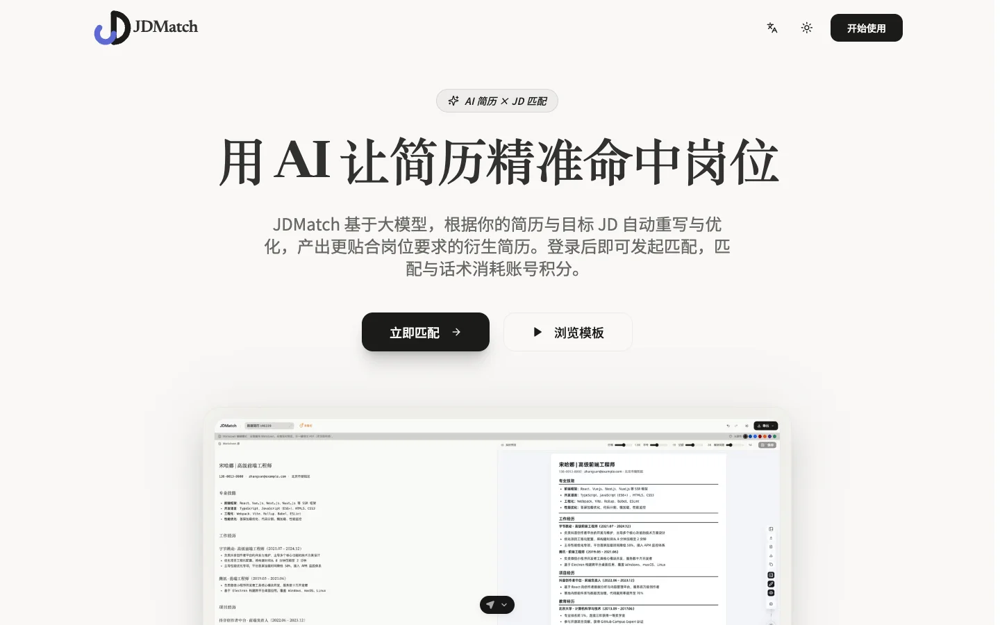
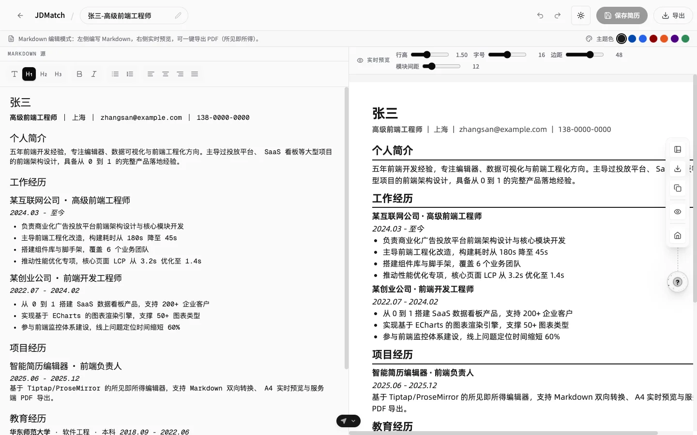
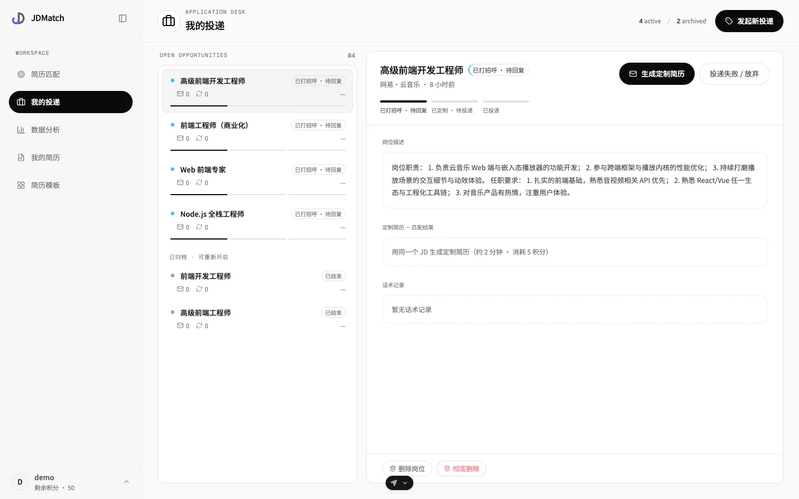
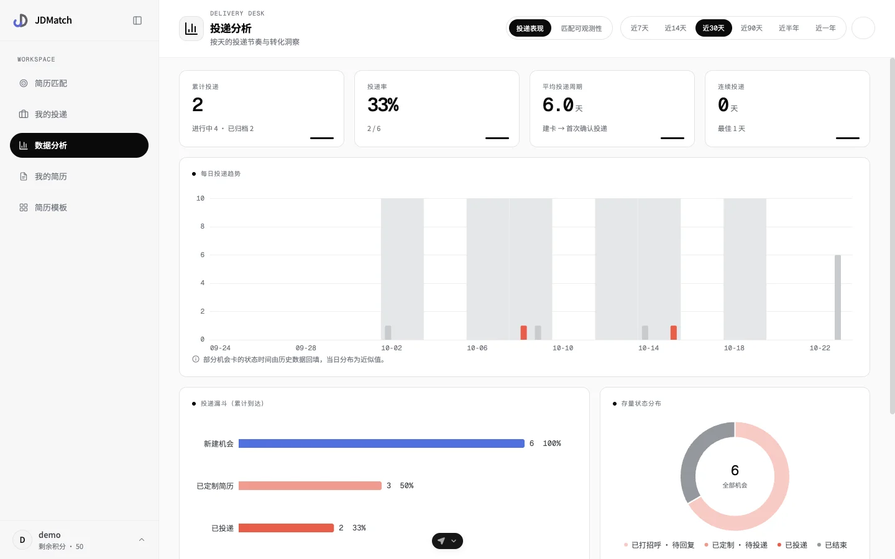

# JDMatch · AI 简历匹配与定制助手

[](https://polyformproject.org/licenses/noncommercial/1.0.0)

> AI Resume Matcher & Tailoring for Any JD

上传简历、粘贴目标岗位描述（JD），由大模型完成针对性匹配与改写，产出可直接投递的定制简历与求职话术。配套所见即所得的简历编辑器、A4 实时预览、PDF 导出、岗位投递跟踪与统计分析。

前后端分离：后端为独立的 Python 服务（仓库根目录 `app/`），前端为 `frontend/`（TanStack Start 应用），通过 `/api` 前缀的 REST 接口通信；生产环境经 Nginx 同源代理，前端以相对路径 `/api` 调用，无需跨域。

## 界面预览

> 截图来自本地开发环境，数据为虚构演示内容；高清原图见 [`docs/screenshots/`](docs/screenshots/)。

**落地页** —— 产品介绍与使用入口



**简历工作台** —— 左侧 Markdown 编辑，右侧 A4 实时预览，一键导出 PDF（所见即所得）



**岗位卡与投递跟踪** —— JD 归一化查重建档，操作驱动的投递漏斗状态机



**投递分析** —— 漏斗、每日投递趋势、连续投递天数与转化洞察



## 功能特性

**简历工作台**

- 上传 PDF 简历（自动提取文本存储）或手动创建，数据按用户隔离
- 结构化表单 / Markdown 所见即所得（Tiptap）双编辑模式，右侧 A4 纸张实时预览
- 一键导出 PDF：服务端 headless Chromium 渲染打印版式
- 编辑态 AI 助手：润色、语法检查、简历导入

**AI 匹配与求职话术**

- JD 匹配：以所选简历的 Markdown 文本为对象做针对性优化，「关键词优化 / 全部重写」由 AI 自动判断，无需手动选择
- 求职话术：独立资源，支持生成、二次编辑、重新生成
- 匹配结果可一键「接受」落库为我的简历，支持二次编辑回写

**岗位卡与投递分析**

- 岗位卡（Job Tracking）：JD 归一化查重复用建档，操作驱动的投递漏斗状态机（由操作触发流转，不开放手动切换）
- 投递统计：多时间窗漏斗、区间连续投递（streak）、每日趋势图表（ECharts），口径见 [`docs/ANALYTICS.md`](docs/ANALYTICS.md)

**账号与积分**

- 用户名 + 口令（scrypt 加盐哈希）、HS256 JWT；登出即使该账号已签发令牌立即失效
- 注册码制发放账号；积分（credits）为唯一余额：匹配 5 分/次、话术 1 分/次，LLM 调用前原子预扣、失败自动归还，管理员账号（`credits = -1`）不限

**其他**

- 中英文 i18n；品牌视觉规范见 [`docs/BRAND.md`](docs/BRAND.md)
- 默认接 DeepSeek（OpenAI 兼容端点，可换通义千问 / 智谱等）

## 技术栈

| 层 | 选型 |
| --- | --- |
| 后端 | Python 3.12 · FastAPI · SQLAlchemy 2（async + aiosqlite）· Pydantic v2 · LangChain / LangGraph · Alembic · PyJWT |
| 前端 | React 18 · TanStack Start / Router · Vite 7 · Tailwind CSS 3 · HeroUI · Tiptap v3 · Zustand · ECharts |
| 基础设施 | Docker Compose · Nginx 同源代理 · Playwright（服务端 PDF 渲染）· SQLite |

## 快速开始

> 后端代码位于仓库根目录（`app/`、`pyproject.toml`、`run.py` 等），依赖用 [uv](https://docs.astral.sh/uv/) 管理，无需进入子目录；前端在 `frontend/`，用 pnpm 管理。

### 方式一：一键本地启动（开发模式）

同时拉起后端（uvicorn + reload）与前端（Vite dev）：

```bash
./start.sh            # 直接启动（已装依赖时）
./start.sh --build    # 首次或依赖变更时，强制安装依赖后启动
```

- 前端：http://localhost:3005
- 后端健康检查：http://localhost:8005/health

> 脚本会自动从 `.env.example` 复制生成 `.env`（若不存在），填入 `LLM_API_KEY` 等配置后重启。

### 方式二：Docker Compose 一键部署（生产模式）

```bash
cp .env.example .env          # 填入 LLM_API_KEY 等
docker compose up -d --build  # 构建并后台启动 nginx + 后端 + 前端
```

- 前端（经 Nginx 同源代理）：http://localhost
- 健康检查：http://localhost/health

架构：`nginx` 是唯一对外入口（宿主仅暴露 80/443），`/` 转发到 `frontend:3005`，`/api` 与 `/health` 转发到 `backend:8005`；两个业务容器不直映宿主端口，仅容器网络内可见。SQLite 数据持久化在 `backend-data` 卷（`/app/data/jobmatch.db`）。启用 HTTPS 与反代细节见 `nginx/` 与 `docker-compose.yml` 内注释。

常用命令：

```bash
docker compose ps             # 查看状态
docker compose logs -f        # 查看日志
docker compose down           # 停止并移除容器（保留数据卷）
```

### 方式三：分服务手动启动

```bash
# 后端
uv sync --no-dev              # 创建 .venv 并安装依赖
cp .env.example .env          # 填入 LLM_API_KEY 等
uv run uvicorn app.main:app --host 0.0.0.0 --port 8005 --reload

# 前端（另开终端）
cd frontend
pnpm install
pnpm dev                      # http://localhost:3005
```

## 登录、注册码与积分

所有业务接口（简历 / 匹配 / 话术 / 岗位）与 AI 接口都要求登录——后端统一持有 `LLM_API_KEY`，接口匿名可调用等同于公开额度。

- 注册需提供注册码（`POST /api/auth/register` 的 `code` 字段），可用 `AUTH_ALLOW_REGISTRATION=false` 关闭注册
- 注册码自助领取：`GET /api/auth/registration-code/status` 查看当日剩余名额与重置时间，`POST /api/auth/registration-code` 领取一枚；全站每日限量（`REGISTRATION_DAILY_LIMIT`，默认 10，北京时间 0 点重置），每个网络每日限领 3 个，有效期 `REGISTRATION_CODE_VALIDITY_DAYS`（默认 30 天）
- 积分：注册码授予（默认 50），JD 匹配 5 分/次（`RESUME_MATCH_COST`）、话术生成/重生成 1 分/次（`COVER_LETTER_COST`），两者共享同一余额；不足时消耗型接口返回 403
- 初始账号（即管理员，`credits = -1` 无限）由 `AUTH_BOOTSTRAP_USERNAME` / `AUTH_BOOTSTRAP_PASSWORD` 配置，服务启动时自动创建并接管登录前的历史数据

## 配置（环境变量）

复制 `.env.example` 为 `.env` 后按需修改；完整列表见 [`.env.example`](.env.example) 与 [`AGENTS.md`](AGENTS.md)。常用项：

| 变量 | 说明 |
| --- | --- |
| `LLM_API_KEY` | 大模型 API Key（必填，缺失时匹配接口返回 503） |
| `LLM_BASE_URL` / `LLM_MODEL` / `LLM_PROVIDER` | OpenAI 兼容接口地址、模型名、厂商标识（默认 DeepSeek） |
| `CORS_ORIGINS` | 允许的前端来源 |
| `DATABASE_URL` | SQLite 路径（默认 `sqlite+aiosqlite:///./jobmatch.db`） |
| `AUTH_SECRET_KEY` | JWT 签名密钥（生产必填，≥32 字节；留空则重启即失效） |
| `AUTH_TOKEN_EXPIRE_MINUTES` | 登录令牌有效期（分钟，默认 10080） |
| `AUTH_ALLOW_REGISTRATION` | 是否开放注册（默认 true） |
| `AUTH_BOOTSTRAP_USERNAME` / `AUTH_BOOTSTRAP_PASSWORD` | 初始账号（管理员），创建时接管历史数据 |
| `REGISTRATION_DEFAULT_CREDITS` | 注册码默认授予积分（默认 50，匹配与话术共享） |
| `RESUME_MATCH_COST` / `COVER_LETTER_COST` | 匹配 / 话术单次消耗积分（默认 5 / 1） |
| `REGISTRATION_DAILY_LIMIT` / `REGISTRATION_CODE_VALIDITY_DAYS` | 注册码每日发放上限（默认 10）/ 有效期（默认 30 天） |
| `PDF_EXPORT_FONT_ORIGIN` | 服务端 PDF 渲染的字体源（compose 默认 `http://frontend:3005`；本机 uvicorn 直跑需设 `http://localhost:3005`） |

## 数据库迁移

Schema 由 Alembic 统一管理（`migrations/`），应用启动时自动执行 `alembic upgrade head`（幂等）。**重启即自动升级，重启前先备份**，需要回退时把备份拷回 `jobmatch.db` 即可：

```bash
cp jobmatch.db "jobmatch.db.bak.$(date +%Y%m%d%H%M%S)"
```

常用命令（仓库根目录、`.venv` 就绪）：

```bash
uv run alembic upgrade head      # 升级到最新（应用启动会自动执行）
uv run alembic history           # 查看迁移历史
uv run alembic current           # 查看当前版本
uv run alembic revision --autogenerate -m "描述本次变更"
uv run alembic downgrade -1      # 回滚一步
```

## API 一览

除 `/api/auth/*` 与 `/health` 外均需携带 `Authorization: Bearer <token>`。交互式文档：启动后访问 `/docs`（Swagger UI）。

| 资源 | 端点 |
| --- | --- |
| 认证 | `POST /api/auth/register` · `POST /api/auth/login` · `POST /api/auth/logout` · `GET /api/auth/me` · `POST /api/auth/change-password` · `GET /api/auth/registration-code/status` · `POST /api/auth/registration-code` |
| 简历 | `POST /api/master-resumes`（上传 PDF）· `POST /api/master-resumes/json` · `GET /api/master-resumes` · `GET / PUT / DELETE /api/master-resumes/{id}` |
| 匹配 | `POST /api/derived-resumes`（触发 Agent）· `GET /api/derived-resumes` · `GET / PUT /api/derived-resumes/{id}` · `POST /api/derived-resumes/{id}/accept` |
| 话术 | `POST /api/cover-letters` · `GET /api/cover-letters` · `GET / PUT / DELETE /api/cover-letters/{id}` · `POST /api/cover-letters/{id}/regenerate` |
| 岗位卡 | `GET /api/jobs` · `GET /api/jobs/stats` · `GET / PATCH / DELETE /api/jobs/{job_id}` · `POST /api/jobs` · `POST /api/jobs/{job_id}/mark` · `POST /api/jobs/{job_id}/reopen` · `POST /api/jobs/detect` |
| AI | `POST /api/ai/polish` · `POST /api/ai/grammar` · `POST /api/ai/resume-import` |
| 导出 | `POST /api/export/pdf` |

## 项目结构

```
matcher/
├── app/                # 后端（FastAPI）
│   ├── api/            # 路由层（auth / resume / match / cover_letter / jobs / ai / export ...）
│   ├── core/           # 配置、数据库、LLM 客户端
│   ├── models/         # SQLAlchemy 模型
│   ├── schemas/        # Pydantic 请求/响应模型（与前端共用 ResumeData 契约）
│   └── services/       # 业务逻辑、Agent、LLM 调用
├── frontend/           # 前端（TanStack Start + React + Vite）
├── migrations/         # Alembic 迁移
├── nginx/              # 生产反代与 HTTPS 配置
├── docs/               # 项目文档（方案 / 修复复盘 / 规范，入口 docs/README.md）
├── tests/              # 后端测试（pytest）
├── scripts/            # 运维脚本
├── docker-compose.yml  # 前后端一体编排（nginx + backend + frontend）
└── start.sh            # 本地一键启动（开发模式）
```

## 文档

| 文档 | 内容 |
| --- | --- |
| [`AGENTS.md`](AGENTS.md) | 工程约定、环境变量、常用命令 |
| [`docs/README.md`](docs/README.md) | 文档地图（活跃 / 归档） |
| [`docs/BRAND.md`](docs/BRAND.md) | 品牌视觉规范 |
| [`docs/ANALYTICS.md`](docs/ANALYTICS.md) | 投递统计口径 |
| [`Plan.md`](Plan.md) | 路线图（批次、优先级、验收） |
| [`CHECKLIST.md`](CHECKLIST.md) | 需求验收清单 |

## CI/CD

`.github/workflows/deploy.yml`：推送后经 rsync 上传代码，在服务器本地顺序构建 backend/frontend 镜像（构建期间保留现有服务，两个镜像就绪后才进入迁移阶段），随后备份数据库、执行迁移并做健康检查。镜像层、APT 与 Playwright 下载缓存保留在服务器，缩短后续构建。

## 开源许可

本项目采用 [PolyForm Noncommercial License 1.0.0](https://polyformproject.org/licenses/noncommercial/1.0.0)（PolyForm 非商业许可证 1.0.0）——源码可见，个人与非商业组织可自由使用、修改、分发，**禁止商用**：

- ✅ **允许**：个人学习、研究、试验、测试、个人项目等非商业用途的使用、修改与分发
- ✅ **允许**：慈善组织、教育机构、公共研究机构、公共安全/健康机构、环保组织、政府机构使用（无论资金来源）
- ❌ **禁止**：任何商业用途——包括但不限于将本项目（或其修改版）用于商业产品、对外提供付费服务 / SaaS、企业内部商业部署等
- 💼 **商业授权**：如需商业使用，请联系作者单独获取授权：<https://github.com/qiugu>

完整条款以仓库根目录 [`LICENSE`](LICENSE) 为准（英文原文具有法律效力）。

## 免责声明

本项目按「现状」提供，不附带任何明示或默示担保，使用风险由使用者自行承担。请遵守目标网站与大模型服务商的使用条款，勿将本项目用于任何违法用途。
