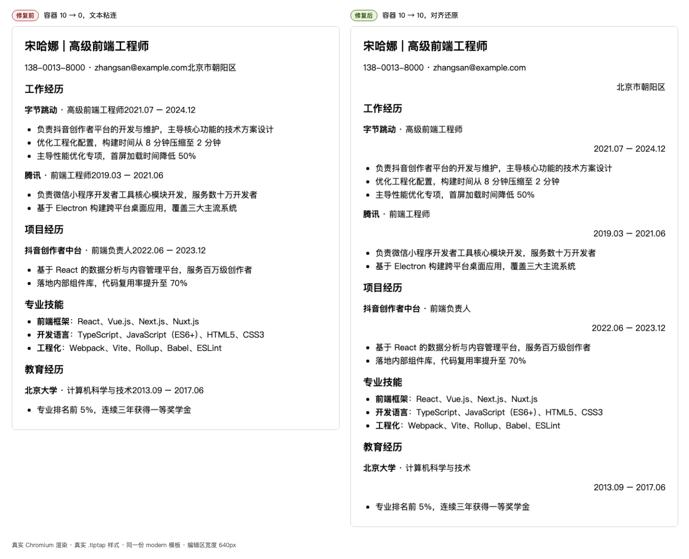

# 编辑态对齐作用域：整块对齐的合理性论证与两个缺陷修复

> 触发问题（用户原话）：
> 「选中部分文本，使用 markdown 顶部的工具栏，设置居右对齐，选中文本整行居右对齐，而不是选中文本居右对齐，这是否合理？」
>
> 日期：2026-09-11 ｜ 影响范围：`frontend/`（Markdown 编辑器 + 模板 + 预览管线）
>
> **后续变更（2026-10-29）**：本文论证的「部分选区 → 整块生效」已被产品决策推翻。
> 现行为「包裹选区」—— 单块内部分选区只把选中文字拆成独立对齐块；本文的块级
> 论证仅对**光标 / 整块选区 / 跨多块 / 嵌套块**仍然成立。详见
> `PLAN_editor_align_selection.md`。

---

## 一、结论（TL;DR）

| # | 事项 | 判定 | 状态 |
| --- | --- | --- | --- |
| 1 | 「选中部分文字 → 整块对齐」是否符合标准 | **合理，且是本产品应有的语义**（非缺陷） | 无需修改，已用测试钉为契约 |
| 2 | 工具栏对齐按钮**从不显示高亮态** | **真实缺陷**（判定写法错误） | **已修复** |
| 3 | 模板中的「同一行左右分布」写法在编辑器里**被压平、结构丢失** | **真实缺陷**（严重：静默损毁用户内容） | **已修复**（方案 C，见第五章） |

第 1 项是「期望澄清」，第 2、3 项是验证过程中实测发现的真实缺陷，均已修复并有回归测试与真实浏览器证据。

---

## 二、问题一：对齐作用于整块，是否合理

### 2.1 结论：合理。这不是实现偷懒，而是 CSS 与业界的一致约束。

「选中文本的**一部分**，只让那一部分居右」在排版模型里**不存在**。理由是分层的：

1. **CSS 层**：`text-align` 是**块级**属性，作用对象是**块容器**（block container box）的行盒（line box）集合。行内元素（`<span>`、文本节点）不是块容器，对它声明 `text-align` 无任何效果。语言层面没有「一行内局部右对齐」的表达方式。
2. **业界层**：Word、Google Docs、Notion、Feishu 文档、以及 Tiptap 官方的 `@tiptap/extension-text-align` 全部把对齐定义为**段落级（block）**属性。选中一段中的几个字再点居右，结果同样是整段居右。这是用户已被普遍训练过的预期行为。
3. **本产品三层实现层**（三者语义一致，缺一不可）：

| 层 | 载体 | 作用域 |
| --- | --- | --- |
| markdown 源 | `:::left` / `:::center` / `:::right` 容器（`utils/markdownRender.ts`） | 块 |
| 编辑器文档 | `paragraph` / `heading` 上的**全局属性** `align`（`extensions/align.ts`） | 块 |
| 预览渲染 | `.md-align-*` 上的 `text-align` / flex（`MarkdownPreview.tsx`） | 块 |

因此「选区只决定**作用于哪些块**，不决定行内哪几个字被对齐」是三层贯通的设计，而非缺陷。

> **反向论证**：若强行做成「行内局部对齐」，第三层必须引入行内对齐模型 —— 这与预览管线的块级 `text-align` / flex 完全不兼容，`:::left/right` 单行配对、Markdown→PDF 导出、打印分页都要跟着改，收益为零（用户无法区分「同一行里几个字右移」与「整块右对齐」的视觉差异，除非加缩进 hack，那会破坏纯文本 markdown 的可移植性）。

### 2.2 但存在一个真实的体验缺口（非缺陷，建议项）

块级语义正确，**但 UI 没有把「作用域是块」这件事告诉用户**。用户点居右时若只选中了几个字，会自然产生「为什么整行动了」的疑问 —— 这正是本次提问的由来。

可选改进（未实施，属体验优化）：

- 工具栏 hover 提示从「居右对齐」改为「居右对齐（整段）」，toast/tooltip 明确作用域；
- 或在选区非空且未覆盖整块时，状态栏提示「已对 N 个段落应用对齐」。

---

## 三、缺陷一：工具栏高亮恒灭（已修复）

### 3.1 根因

`MarkdownEditor.tsx` 原先用 **「类型名 + 属性」** 形式判定高亮：

```tsx
active={editor.isActive("align", { align: "right" })}   // ✗ 恒为 false
```

Tiptap 的 `isActive(nameOrAttributes, attributes)` 在第一参数为字符串时，会调用 `getSchemaTypeNameByName(name)` 在 **schema 的 nodes / marks 注册表**中查找该名字：

- `align` 是通过 `addGlobalAttributes()` 挂到 `paragraph` / `heading` 上的**属性**，schema 中**不存在**名为 `align` 的节点或标记类型；
- 于是 `getSchemaTypeNameByName("align")` 返回 `null`，`isActive` 直接 `return false`（源码路径：`@tiptap/core` 的 `isActive` 辅助函数）。

**后果**：居左 / 居中 / 居右三个按钮**永远不会高亮**，用户无法判断当前块是否已对齐、对齐到哪一侧 —— 这也是「整行居右」看起来更可疑的原因之一（点完按钮毫无反馈，只有正文整体位移）。

### 3.2 实测证据（真实 Chromium）

用仓库内的往返探针（`frontend/scripts/editor-probe/`）在真实浏览器里对同一份文档断言：

```json
"activeProbe": {
  "isActive(\"align\", { align: \"right\" })": false,   // ← 旧写法，恒 false
  "isActive({ align: \"right\" })": true               // ← 新写法，正确
}
```

### 3.3 修复

改为**只给属性**的调用形式（属性匹配无需类型名）：

```tsx
active={editor.isActive({ align: "right" })}   // ✓
```

涉及文件：`frontend/src/components/editor/MarkdownEditor.tsx`（居左 / 居中 / 居右三处），并就地补充注释说明「为什么不能带类型名」，防止后人改回。

---

## 四、缺陷二：配对行在编辑器里被压平（已修复）

### 4.1 现象

内置模板中用「同一行左右分布」表达「联系方式 | 城市」「公司·职位 | 日期」等信息，写法为**紧凑单行配对**：

```
:::left 138-0013-8000 · zhangsan@example.com ::: :::right 北京市朝阳区 :::
```

在预览 / 导出中渲染正常（flex 同行，左文右文分列）。但**在编辑器中打开即被压平**：

```json
"inlinePair": {
  "before": ":::left 138-0013-8000 · zhangsan@example.com ::: :::right 北京市朝阳区 :::",
  "after":  "138-0013-8000 · zhangsan@example.com北京市朝阳区",
  "editorHtml": "<p>138-0013-8000 · zhangsan@example.com北京市朝阳区</p>"
}
```

**两个 `:::` 容器、两侧的对齐信息全部丢失，且两段文字被无分隔符直接粘连**（`…example.com北京市朝阳区`）。用户只要在编辑器里改动任意一处，回写就把这个损毁版本永久保存。

### 4.2 根因

三层能力不对齐 —— **预览层支持「同行左右配对」，编辑器文档模型没有对应节点**：

| 层 | 对紧凑配对的支持 |
| --- | --- |
| 预览（`markdownRender.ts` 第 144–187 行「单行内联模式」） | ✅ 输出 `<p class="md-align-inline-pair"><span class="md-align-left">…</span><span class="md-align-right">…</span></p>`，由 `MarkdownPreview.tsx` 的 flex 规则同行渲染 |
| 编辑器（`extensions/align.ts` 的 `updateDOM`） | ❌ **显式跳过**。源码注释原文：「仅处理单段（left+right 双段无法映射为单一块属性，保持原样不改）」—— 判定条件是 `p` 内 `span.md-align-*` 兄弟数 `!== 1` 就 `return` |

跳过后，两个 `<span class="md-align-*">` 在 Tiptap schema 中无对应标记，**被当作无意义包装剥离**，其文本子节点按文档顺序合并进同一段落 → 结构丢失 + 文本粘连。

> 这是一个**已知但被低估**的限制：注释写的是「保持原样不改」，实际结果不是「保持不变」，而是**降级损毁**。

### 4.3 影响面

命中范围**仅限 `modern`（现代）模板**，中文与英文各 5 处、共 10 处：

| 位置 | 内容 |
| --- | --- |
| 中文 `samples.ts` 第 60 行 / 英文第 453 行 | 联系信息行（电话 · 邮箱 \| 城市） |
| 中文 64 / 70 / 77 行、英文 457 / 463 / 470 行 | 每一条工作经历与项目的「公司 · 职位 \| 日期」 |
| 中文 90 行 / 英文 483 行 | 教育经历「学校 · 专业 \| 日期」 |

其余模板（`classic` / `elegant` / `swiss` / `left-right` / `timeline` / `minimalist` / `creative` / `editorial`）**不受影响** —— 其中 `left-right` 模板本就使用块形式（`:::left` 与 `:::right` 各自成块），是本次修复所采用的规范写法。

触发路径已确认可达：`CreateResumeModal`（新建简历选模板）与 `ResumeWorkbench`（切换模板）都会把样例 markdown 灌入编辑器。用户手写同样的紧凑写法时同样命中。

### 4.4 关键证据：两种写法在预览侧**渲染等价**

在 node 环境直接调用预览管线（`renderMarkdownToHtml`）对比三种写法：

| 写法 | 渲染结果 |
| --- | --- |
| 紧凑配对（现状） | `<p class="md-align-inline-pair"><span class="md-align-left">138-0013-8000</span><span class="md-align-right">北京市朝阳区</span></p>` |
| 双块配对（手写） | `<div class="md-pair-row"><div class="md-align-left"><p>138-0013-8000</p></div><div class="md-align-right"><p>北京市朝阳区</p></div></div>` |
| 双块配对（**编辑器序列化器实际输出**，块后多一空行） | 与上式**逐字节相同** |

且两组 CSS 规则（`MarkdownPreview.tsx` 第 698–715 行与第 718–743 行）产出的视觉一致：同为 `display:flex`、`align-items:baseline`、`gap:1rem`，右侧 `white-space:nowrap`。

**结论**：块形式（`:::left\nX\n:::\n\n:::right\nY\n:::`）是紧凑形式在预览侧的**完全等价替代**，且表达力更强（块内容可含列表 / 多段，紧凑形式只能放单行行内内容）。

### 4.5 候选方案与决策

| 方案 | 做法 | 优点 | 代价 |
| --- | --- | --- | --- |
| **A. 新增配对节点** | 在 Tiptap schema 增加一个两列块节点（`alignPair`），补 parse / serialize / NodeView | 编辑器内即见「同行左右」真容，完全 WYSIWYG；往返无损 | 改动最大：新增 schema 节点 + NodeView 样式 + 光标在双列间的移动/删除语义；需处理 ProseMirror「块内不能嵌行内」的约束（须做块节点含两个块子节点） |
| **B. 模板改写为块形式** | 把 10 处紧凑写法改为 `:::left` 块 + `:::right` 块 | 改动最小（纯数据）；预览输出零变化 | 只治模板、不治用户手写；编辑器内仍显示为上下两段 |
| **C. 解析期拆分配对** ✅ **已采纳** | 在 `align.ts` 的 `updateDOM` 把配对段落拆成两个段落（`align=left` / `align=right`），交由现有序列化器输出块形式 | **消除数据损毁**；无需 schema 变更；模板与用户手写同时受益；预览输出零变化 | 编辑器内显示为上下两段（与 B 相同的 WYSIWYG 折中）；首次编辑会把一段变两段（属预期，非丢失） |

**决策**：执行 **C**（用户确认）。理由：C 直接消除数据损毁，且不引入 schema 变更；B 只是数据层绕行、不覆盖用户手写路径；A 是真正的 WYSIWYG 但属独立的 schema 级任务，可作为后续增强。

### 4.6 实现

`frontend/src/components/editor/extensions/align.ts`，三处改动：

1. **新增 `splitInlineAlignPair(paragraph)`**：把段落里 ≥2 个 `span.md-align-*` 各自的子节点搬进新建的 `<p align="…">`，按原顺序插回原段落位置，最后移除原段落。
   - **先校验齐备再改 DOM**：逐个取对齐名，任一取不出就整体放弃 —— 避免「改了一半」把前段搬走、后段留在被移除的原段落里丢掉。
   - **搬运子节点而非文本**：`while (span.firstChild) block.appendChild(span.firstChild)`，保留 `strong` / `em` / `a` 等行内标记。
   - 用 `hasOtherInlineContent()` 做**白名单**判定：只承认对齐 span 与纯空白文本，混有其它内容则放弃拆分（宁可维持现状，也不静默丢弃内容）。
2. **`updateDOM` 的「单行内联」分支**由「兄弟 span 数 `!== 1` 就 return」改为按段落去重后分流：单段维持原逻辑（整段对齐 + 去壳），多段调用 `splitInlineAlignPair`。
3. 文件头补充「解析侧处理的三种标记形态」说明。

**往返闭环**：拆分后两个段落 → 序列化器输出 `:::left` 块 + `:::right` 块 → 预览侧 `alignPairRow` 规则把相邻的 `:::left` / `:::right` 块**重新合并为同一行**，与紧凑形式的渲染结果一致。

### 4.7 实测结果（真实 Chromium，`modern` 模板整篇往返）

| 指标 | 修复前 | 修复后 |
| --- | --- | --- |
| `:::` 容器数（入 → 出） | **10 → 0**（全部丢失） | **10 → 10** |
| 联系信息行 | `138-0013-8000 · zhangsan@example.com北京市朝阳区`（**粘连**） | `138-0013-8000 · zhangsan@example.com` + 独立成段的右对齐 `北京市朝阳区` |
| 经历行（字节跳动） | `**字节跳动** · 高级前端工程师2021.07 – 2024.12`（**粘连**） | `**字节跳动** · 高级前端工程师` + 右对齐 `2021.07 – 2024.12` |
| 幂等性（产物再喂回） | — | 第二次与第一次输出**完全一致**（不再漂移） |
| 单段内联（`:::left X :::`） | 1 段 + `align=left` | 1 段 + `align=left`（**无回归**） |
| 三段内联（left/center/right） | 压平丢失 | 3 段，align 依次 `left`/`center`/`right` |
| 行内标记（`**字节跳动**`） | 丢失对齐 | `<strong>` **保留** |



*图：同一份 `modern` 模板、同一编辑区宽度（640px）、真实 Chromium + 真实 `.tiptap` 样式。左为修复前（文本粘连、右侧日期丢失），右为修复后（左右信息各自成段、对齐还原）。*

**取舍（已知且被接受）**：编辑器内该行显示为**上下两段**而非预览中的一行 —— Tiptap 文档模型没有「同行左右分列」的节点，要消除这一折中需实施方案 A。数据无损与预览正确性不受影响。

---

## 五、验证与回归

### 5.1 回归测试

| 文件 | 用例数 | 钉住的契约 |
| --- | --- | --- |
| `frontend/tests/editor-align-scope.test.ts` | 7 | 部分选区只作用于整块（非行内）／跨块选区全生效／光标无选区只作用于当前块／重复写入返回 false／保留块上其它属性／`align` 是全局属性而非 schema 类型／工具栏只用「仅属性」的 `isActive` |
| `frontend/tests/editor-align-pair.test.ts` | 10 | 序列化产物（块形式）被预览合并为同一行 / 块间无空行也能配对 / 存量紧凑写法向后兼容 / 单段内联不被误当配对行 / 源码不再有「兄弟 span 数 ≠ 1 就 return」的旧写法 / 搬运子节点而非文本 / 有其它内容时不拆分 / 先校验再改 DOM |

```bash
cd frontend && npx vitest run tests/editor-align-pair.test.ts tests/editor-align-scope.test.ts
# ✓ 17 passed
```

> 分层说明：编辑器侧的 DOM 行为由 `frontend/scripts/editor-probe/` 在真实 Chromium 中验证（本项目 vitest 为 node 环境、无 jsdom）；`editor-align-pair.test.ts` 负责 node 可验证的部分 —— 预览渲染契约（纯函数）与源码级契约。

### 5.2 全量测试

```bash
cd frontend && npx vitest run
# Test Files  1 failed | 9 passed (10)
# Tests       6 failed | 90 passed (96)
```

**6 项失败全部来自既有的 `tests/classify-description.test.ts`，与本次改动无关**：它导入的 `createResumeFromAIResult`、`renderDescriptionRows` 已从 `src/app/app/dashboard/resumes/utils.ts` 移除（该文件现仅导出 `escapeHtml` / `toString`），属**测试未随源码下线同步**的历史遗留。建议单独清理（删除或改为覆盖当前实现），否则全量测试长期红着，无法用于回归判定。

### 5.3 自建工具：编辑器往返探针

`frontend/scripts/editor-probe/`（新增，可重复运行）：

```bash
cd frontend && node scripts/editor-probe/run.mjs                  # 往返 JSON 断言
cd frontend && node scripts/editor-probe/run.mjs --shot out.png   # 截图真实编辑区（修复前后对比）
```

用途：在真实 Chromium 中验证「markdown → Tiptap 文档 → markdown」的往返保真度，并可截图真实编辑区形态。本项目的 vitest 环境是 node（无 jsdom），而编辑器的解析/序列化链路依赖真实 DOM 与真实 schema，读代码无法判断某段 markdown 会变成什么 —— 探针通过 Vite 打包一个最小页面 + Playwright 运行来补齐这段可观测性。新增用例只需编辑 `scripts/editor-probe/main.js` 的 `__probe()`。

> 已知坑（已写入脚本注释）：
> 1. Tiptap 的 `create` 事件是**异步**触发的，`Align` 的序列化器补丁就在 `onCreate` 里；`new Editor()` 返回时补丁尚未装上，必须 `await` 一个 tick 再断言，否则会得到「补丁没生效」的假阴性。
> 2. 探针目录变更后 `vite.config.mjs` 的 `@` 别名需重算上溯级数（现为 `../../src`）。
> 3. 采集「修复前」对照数据可用 `git show HEAD:<path> > <path>` 临时替换实现，跑完再还原 —— 比凭记忆推断可靠。

---

## 六、涉及文件

| 文件 | 变更 |
| --- | --- |
| `frontend/src/components/editor/extensions/align.ts` | 新增解析期配对拆分（方案 C）+ 三种标记形态说明（缺陷二修复） |
| `frontend/src/components/editor/MarkdownEditor.tsx` | 三处 `isActive` 改为仅属性形式 + 说明注释（缺陷一修复） |
| `frontend/tests/editor-align-scope.test.ts` | 新增（7 例） |
| `frontend/tests/editor-align-pair.test.ts` | 新增（10 例） |
| `frontend/scripts/editor-probe/{run.mjs,main.js,index.html,vite.config.mjs}` | 新增（往返探针 + 截图工具） |
| `docs/editor-align-pair-before-after.png` | 新增（修复前后对比图） |
| `docs/FIX_editor_align_scope.md` | 本文件 |
| `docs/README.md` | 索引登记 |

## 七、遗留项

| 项 | 说明 | 建议 |
| --- | --- | --- |
| 方案 A（真 WYSIWYG 双列） | 编辑器内配对行仍显示为上下两段 | 独立 schema 级任务，按需排期 |
| `modern` 模板源码仍为紧凑写法 | 数据无损往返已由解析期拆分保证，改不改纯属可读性偏好 | 可并入方案 A 一并处理 |
| `tests/classify-description.test.ts` | 6 例长期失败（目标函数已下线） | 单独清理 |
