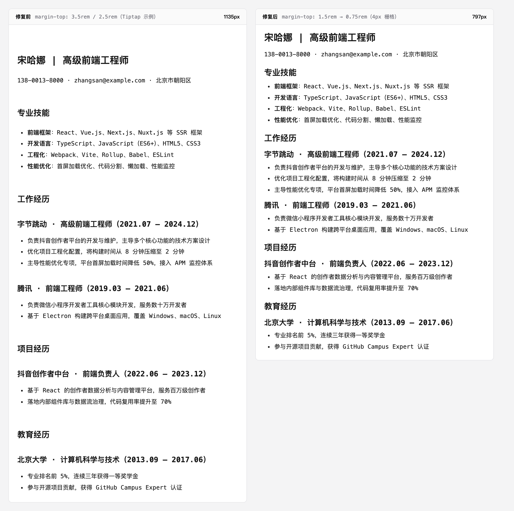

# FIX · 编辑态标题垂直节奏（2026-09-11）

> 范围：`frontend/src/styles/tiptap.scss`（`.tiptap` 作用域）· 回归测试 `frontend/tests/editor-heading-rhythm.test.ts`
> 影响面：简历工作台「Markdown 编辑」面板 + 表单模式富文本字段（`.tiptap` 共用同一份样式）
> **不影响**：产出态（右侧实时预览 / PDF 导出 / 打印），其内容根节点是 `.resume-markdown-preview`，从不带 `.tiptap`

## 一、现象

简历编辑页面（`/app/workbench/[id]` → Markdown 编辑模式）中 H1 / H2 / H3 等标题的上下留白明显过大：
编辑区一屏放不下几个模块，滚动成本高；且与右侧实时预览的疏密完全对不上，「所见非所得」。

## 二、根因

标题间距直接照搬了 [Tiptap 官方示例样式](https://tiptap.dev)（其 StarterKit 演示页 CSS），
而那是为**长文正文**（博客、文档站）校准的排版尺度：

| 选择器 | 历史值 | 折算 | 适用场景 |
| --- | --- | --- | --- |
| `h1, h2` | `margin-top: 3.5rem` / `margin-bottom: 1.5rem` | 56px / 24px | 长文正文章节 |
| `h3–h6` | `margin-top: 2.5rem` | 40px | 长文正文章节 |
| 全部标题 | `line-height: 1.1` | — | 大字号展示标题 |
| `p` | 无间距（被 `globals.css` 的 `* { margin: 0 }` 归零） | 0 | — |

对照产出态的实际排版（`MarkdownPreview.tsx` + `markdownVariants.ts`）：
`h2` 上间距默认只有 `moduleSpacing = 12px`，`h3` 上间距为 `lineUnit × 0.25 ≈ 6px`。

**编辑态 : 产出态 ≈ 56px : 12px ≈ 4.7 : 1** —— 相差近 5 倍，这是问题的量化根因。
（附带问题：段落间距为 0 而标题间距 40–56px，节奏严重不均，「标题像被上一段拉走」。）

## 三、修复

改为 4px 栅格上的紧凑节奏（与 Tailwind 默认 spacing scale 同源），并遵守**邻近性原则**：
标题的「上间距 : 下间距」≈ 3 : 1，使其在视觉上归属于**下方**内容。

| 层级 | 上间距 | 下间距 | 上:下 | 字号（保持不变） |
| --- | --- | --- | --- | --- |
| `h1` | 1.5rem（24px） | 0.5rem（8px） | 3.0 : 1 | 1.4rem |
| `h2` | 1.25rem（20px） | 0.375rem（6px） | 3.3 : 1 | 1.2rem |
| `h3` | 0.875rem（14px） | 0.25rem（4px） | 3.5 : 1 | 1.1rem |
| `h4–h6` | 0.75rem（12px） | 0.25rem（4px） | 3.0 : 1 | 1rem |
| 行高 | `1.3`（原 `1.1` 会让换行标题行距小于字号本身） | | | |
| 首/末块 | `.tiptap > :first-child { margin-top: 0 }` / `> :last-child { margin-bottom: 0 }` | | | |

两条关键设计决策：

1. **用 `rem` 而非 `em`。** 编辑态各层级标题分隔的是同级结构块（`h2` = 模块、`h3` = 条目），
   若按自身字号算 `em`，`h1`（1.4rem）的留白会明显大于 `h3`（1.1rem），节奏反而不齐。
2. **字号一律不动。** 现值的「编辑器 14px 正文 / 预览 16px 正文」比例与产出态基本一致
   （`h1` 1.6x ↔ 1.75x，`h2` 1.37x ↔ 1.375x），同步改字号会破坏这层对应关系。

## 四、验证

### 1. 量化对比（同一份 `classic` 模板简历样例）

用 Playwright 渲染同一份简历内容，分别套用修复前 / 修复后的 `.tiptap` 样式并测量内容高度：

| | 内容高度 | 差异 |
| --- | --- | --- |
| 修复前 | 1135px | — |
| 修复后 | 797px | **−338px（−29.8%）** |



> 左：修复前（Tiptap 示例尺度）· 右：修复后（4px 栅格节奏）。两列内容、字号、宽度完全一致，仅标题间距不同。

### 2. 回归测试

`frontend/tests/editor-heading-rhythm.test.ts`（18 例，全绿）钉住以下不变量：

- 不再出现 `margin-top: 2.5rem / 3.5rem`、`margin-bottom: 1.5rem` 等长文尺度值；
- 各层级上间距落在 12–28px、下间距落在 2–8px，且上:下 ≥ 2.5 : 1（邻近性）；
- 层级单调：`h1 > h2 > h3 > h4 = h5 = h6`；
- 行高 ≥ 1.2；首/末块外间距归零；
- 字号比例锁定（防止「顺手改字号」破坏与产出态的对应关系）；
- 作用域约束：本文件不得出现顶层裸 `h1/h2` 选择器，且不得为产出态
  （`.resume-preview` / `.resume-markdown-preview`）标题声明间距。

```bash
cd frontend && npx vitest run tests/editor-heading-rhythm.test.ts   # 18 passed
```

## 五、回归风险与边界

- **产出态零影响**：导出/打印 HTML 的内容根节点是 `.resume-markdown-preview`，
  从不带 `.tiptap`；`printHtml.collectDocumentCss()` 虽然会整表序列化应用样式，
  但 `.tiptap` 前缀选择器不可能命中产出内容。已由测试中的作用域约束用例钉住。
- **表单模式富文本字段同受影响**（`shared/rich-editor/RichEditor.tsx` 复用 `.tiptap`）：
  其字号/标题用法与 Markdown 编辑器一致，间距收紧后视觉更统一，属预期收益。
- **未处理项（有意留白）**：`hr`（`2rem`）、`blockquote` / `pre`（`1.5rem`）仍沿用原值，
  它们不在「标题节奏」范围内，且简历正文极少使用。若后续需要统一，应比照本文件的
  4px 栅格口径单独评估。
- **`classify-description.test.ts` 的 6 个失败为既有问题**（`createResumeFromAIResult`
  已从源码移除，测试未同步），与本次改动无关。
